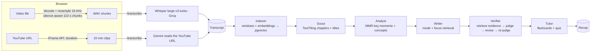

# Recap: verified AI summaries of lectures and videos

Recap is a SaaS that turns a lecture, talk or YouTube video into **chapters, a summary adapted to your goal, key moments, flashcards and a quiz**. Every claim in the summary is **fact-checked against the transcript** and linked to the second it was said.

Built by **Sekhri Mohammed Yassine** (MSc Artificial Intelligence & Data Science).

## Why it is more than "ChatGPT on a transcript"

| Problem with naive LLM summaries | What Recap does |
| --- | --- |
| Long videos overflow the context or get summarised vaguely | Transcript indexed as ~40 s windows of **768-d vectors**: free local TF-IDF (unigrams + bigrams, signed hashing trick) by default, or neural `gemini-embedding-001` (Matryoshka-truncated, re-normalised) with `EMBEDDINGS_PROVIDER=gemini` |
| Chapters are guessed by the LLM | **Embedding TextTiling**: topic shifts are found as deep valleys in the similarity curve between neighbouring windows (Hearst 1997, with sentence embeddings instead of word counts) |
| "Key points" are redundant | **Maximal Marginal Relevance** picks moments that are central yet diverse, capped per chapter, and biased toward the user's question when given |
| Hallucinations | A **Verifier agent** retrieves the 3 closest transcript passages for every claim and labels it supported / partial / unsupported. The Writer then **rewrites rejected claims from the evidence** and they are checked again. The faithfulness score is shown before and after self-correction |
| One summary for everyone | Modes (overview, study notes, exam revision, meeting minutes) and an optional **focus question** used for retrieval |
| Whisper invents text on silence | Segments with high no-speech probability + low log-prob, or a looping compression ratio, are dropped; repeated lines are merged |

## Architecture



- **The video never leaves the user's device.** Audio is decoded and resampled in the browser, cut in pauses, and sent as ~3.5 MB WAV pieces (under the 4.5 MB serverless body limit).
- **The pipeline is a state machine.** Each `/api/recaps/:id/step` call runs one stage and saves it, so requests stay short, progress survives a closed tab, and a failed stage can be retried. An optimistic lock (`update … where status = current`) stops two tabs from running the same stage twice.
- **Model routing within free tiers.** Groq's free plan allows ~8k tokens per minute *per model*, so prompts are budgeted to ~5k tokens and each agent has a chain of models (gpt-oss-120b → Llama 3.3 70B → gpt-oss-20b, or the reverse for fast agents). On a rate limit the call waits if the wait is short, otherwise it moves to the next model. Gemini joins the chain when its key has access.
- **Runs on one free key.** Only `GROQ_API_KEY` is required. A Gemini key is optional: it unlocks YouTube links and neural embeddings.
- **Security.** API keys stay on the server. All data access goes through Supabase Row Level Security with the user's own session (no service-role key). There are daily quotas and a maximum duration per video.

## Tech stack

Next.js 15 (App Router) · TypeScript · Supabase (Auth, Postgres, pgvector, RLS) · Groq (Whisper, gpt-oss) · Google Gemini (LLM, embeddings, video understanding) · Vercel

```
app/                 pages and API routes
  api/recaps/…       create · transcribe · transcript · step · patch/delete
lib/pipeline/        segment.ts (TextTiling, MMR) · agents.ts (prompts + JSON contracts) · run.ts (state machine)
lib/audio/           in-browser audio extraction, silence-aware chunking, WAV encoder
lib/ai/              Groq + Gemini clients, provider fallback
supabase/schema.sql  tables, pgvector, RLS policies
tests/               unit tests (bun test)
```

## Run it yourself

1. **Supabase:** create a free project at [supabase.com](https://supabase.com), open **SQL Editor**, paste and run `supabase/schema.sql`.
2. **Keys:** create a Groq key at [console.groq.com/keys](https://console.groq.com/keys). Optionally add a Gemini key from [aistudio.google.com/apikey](https://aistudio.google.com/apikey) for YouTube links; some accounts need billing enabled for it.
3. **Environment:** copy `.env.example` to `.env.local` and fill in the Supabase URL and anon key (Project Settings → API) and the two AI keys.
4. **Start it:**
   ```bash
   npm install
   npm run dev      # http://localhost:3000
   npm test         # unit tests (needs bun)
   ```
5. **Deploy:** import the repo on Vercel and add the same environment variables. In Supabase → Authentication → URL Configuration, set the Site URL to your Vercel address so confirmation emails link back to it.

## Roadmap

- Evaluation harness: ROUGE + faithfulness on a public lecture dataset, comparing ablations (no MMR, no verifier, LLM-only chapters)
- Visual key frames for slides-heavy lectures
- Pro plan: longer videos, Anki / Notion export
